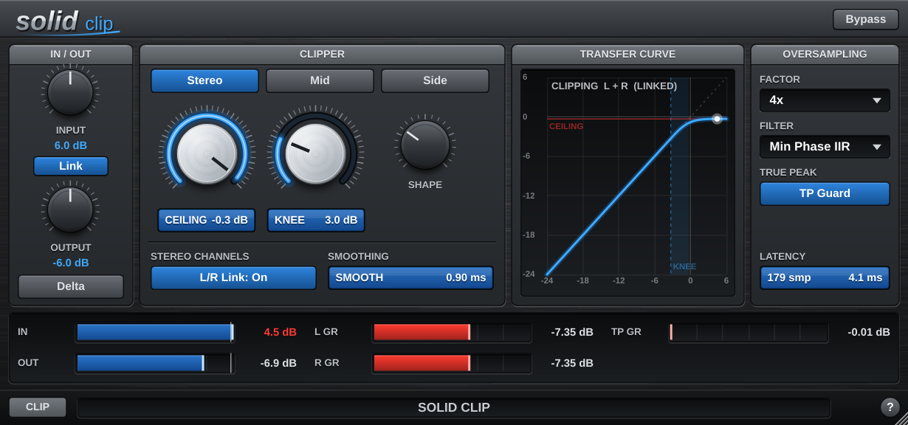

# SolidClip



A transparent, **linked** soft clipper / clipper-limiter hybrid (VST3 + Standalone, AU on macOS), built with JUCE 8 and CMake.

SolidClip holds peaks at a solid, consistent ceiling while adding as little audible distortion as possible. In particular, it adds none to the side channel (L − R) when you solo it. It never shapes the channels separately. Instead it computes **one gain** and applies it to both channels, so the ratio between them, and with it the stereo image, is never changed.

The GUI uses the same look and feel as *Virus Delay*: brushed metal, grey header panels, chrome and blue knobs, blue LCDs. It is freely resizable: drag the bottom-right corner, and everything scales together and stays sharp.

---

## Building

You need CMake ≥ 3.22, a C++17 compiler and Git. JUCE 8.0.4 is downloaded automatically with FetchContent. To use a local JUCE checkout instead, pass `-DJUCE_DIR=/path/to/JUCE`.

### macOS (Xcode or Ninja)

```bash
cmake -B build -G Xcode                    # or: -G Ninja -DCMAKE_BUILD_TYPE=Release
cmake --build build --config Release
ctest --test-dir build -C Release --output-on-failure
```

Output: `build/SolidClip_artefacts/Release/VST3/SolidClip.vst3`, `.../AU/SolidClip.component`, `.../Standalone/SolidClip.app`.
To build a universal binary, add `-DCMAKE_OSX_ARCHITECTURES="arm64;x86_64"`.

### Windows (Visual Studio 2022)

```bat
cmake -B build -G "Visual Studio 17 2022" -A x64
cmake --build build --config Release
ctest --test-dir build -C Release --output-on-failure
```

Output: `build\SolidClip_artefacts\Release\VST3\SolidClip.vst3` and `...\Standalone\SolidClip.exe`.
Copy the `.vst3` folder to `C:\Program Files\Common Files\VST3`, or configure with `-DSOLIDCLIP_COPY_AFTER_BUILD=ON`.

### Linux

```bash
sudo apt install libasound2-dev libfreetype-dev libfontconfig1-dev libx11-dev libxrandr-dev \
                 libxinerama-dev libxcursor-dev libxext-dev libxcomposite-dev
cmake -B build -G Ninja -DCMAKE_BUILD_TYPE=Release
cmake --build build && ctest --test-dir build --output-on-failure
```

### CMake options

| Option | Default | |
|---|---|---|
| `SOLIDCLIP_BUILD_STANDALONE` | ON | Standalone app for quick testing |
| `SOLIDCLIP_BUILD_AU` | ON | Audio Unit (macOS only) |
| `SOLIDCLIP_BUILD_TESTS` | ON | `SolidClipTests` console app, registered with CTest |
| `SOLIDCLIP_COPY_AFTER_BUILD` | OFF | Install into the user plugin folder |
| `JUCE_DIR` | empty | Use a local JUCE checkout instead of downloading it |

---

## Parameters

| Parameter | Range | Default | What it does |
|---|---|---|---|
| **Input** | −12 … +24 dB | 0 dB | Drive into the clipper. With **Link** on, the Output knob moves the opposite way. |
| **Ceiling** | −12 … 0 dBFS | −0.3 | The level nothing gets above: L and R in Stereo mode, the mid in Mid mode, the side in Side mode. |
| **Knee** | 0 … 12 dB | 3 dB | How gently clipping starts. 0 dB = hard clip, flat right up to the ceiling. 3 dB = the curve starts bending 3 dB below the ceiling, which is smoother with fewer harsh harmonics. Below *ceiling − knee* the audio is **untouched** (gain exactly 1.0). The Transfer Curve display shows it. |
| **Shape** | 0 … 100 % | 30 % | 0 % = instantaneous gain (pure clipper). Higher values smooth the gain envelope over up to 3 ms, with matching lookahead (clipper/limiter hybrid). |
| **Oversampling** | 1x / 2x / 4x / 8x / 16x | 4x | Rate at which detection and gain are computed, so inter-sample peaks are caught. |
| **Filter** | Min Phase IIR / Linear Phase FIR | IIR | IIR = low latency. FIR = linear phase, and the output is **bit-identical** to the input below the knee. |
| **Mode** | Stereo / Mid / Side | Stereo | What gets clipped. See below. |
| **L/R Link** | on/off | on | Stereo mode: on = the same gain on L and R, so the stereo image never changes. Off = L and R are clipped independently. |
| **Output** | −24 … +12 dB | 0 dB | Gain after clipping. Raising it moves the output above the ceiling. |
| **Link** (In/Out) | on/off | on | Links the knobs: turning Input up by 3 dB turns the **Output knob** down by 3 dB, so driving harder clips more but **doesn't change the level**. Bypass and Delta stay level-matched. It also follows host automation of Input. You can still move Output on its own as a trim. |
| **Delta** | on/off | off | Outputs *dry − wet*, latency aligned: exactly what is being removed. |
| **TP Guard** | on/off | on | True-peak guard (see below). |
| **Bypass** | on/off | off | Latency-compensated bypass. This is also the host's bypass parameter. |

All continuous parameters are smoothed, and stage, mode, delta and bypass changes crossfade over about 10 ms. Every knob supports drag, shift-drag (fine), the scroll wheel and double-click to reset, and shows its value on hover.

## Modes

- **Stereo** clips the left and right channels. With **L/R Link** on, one gain from `max(|L|, |R|)` goes to both channels. Feed it L = R and the side output is exactly zero; feed it any stereo signal and the L/R ratio of every sample is unchanged. With L/R Link off, each channel is clipped on its own, and L never depends on R.
- **Mid** clips only the mid, M = (L + R) / 2. The side, (L − R) / 2, is **not touched**: L += (g − 1)·M and R += (g − 1)·M.
- **Side** clips only the side, S = (L − R) / 2. The mid is **not touched**: L += (g − 1)·S and R −= (g − 1)·S.

Every mode runs the same signal path with the same latency, so switching modes never shifts timing and is a 10 ms click-free crossfade. The True-Peak Guard follows the mode, so in Mid mode it also leaves the side alone, and vice versa.

---

## How it works

```
input gain ─► up-sample ─► clipper (Stereo / Mid / Side) ─► down-sample ─► TP guard ─► delta / output gain ─► bypass mix
```

**Gain-based clipping.** The clipper builds a detector (|L|, |R|, `max(|L|,|R|)`, |M| or |S|, depending on the mode) and runs it through the soft-clip curve. The curve is linear up to *T = ceiling − knee*. Above that it is `T + K·tanh((d − T)/K)`, which bends only the overshoot and approaches the ceiling asymptotically. Gain = target / detector, exactly 1.0 below *T*. Because the curve acts on a magnitude and the gain multiplies the signed signal, it is odd-symmetric: no DC and no even harmonics.

**Shape (no-overshoot smoothing).** The required gain goes through a lookahead **min-hold**, then **two cascaded moving averages** whose combined length equals the hold window. Every averaged value then comes only from holds that cover the sample it is applied to, so the smoothed gain can never be above that sample's required gain, and peaks never pass the ceiling. The cascaded averages give an S-shaped attack and a fast, smooth release (≤ 3 ms), with no pumping. The averages run on fixed-point integer sums, so there is no floating-point drift, and the gain returns to exactly 1.0.

**Bit-transparency (Linear Phase FIR, and 1x).** Only the *removed* part of the signal (clipped − unclipped) goes through the oversampler. The dry signal is just delayed by exactly the reported latency. When nothing is clipped, the removed part is exactly zero, so the output nulls bit-for-bit against the latency-aligned input. Min-phase IIR filters shift the phase of the whole band, so that path can't be bit-exact by design. In IIR mode the full signal is oversampled, and the result is transparent in level but phase-shifted at high frequencies.

**True-Peak Guard.** Clipping at the oversampled rate creates harmonics above Nyquist, and the down-sampling filter removes them. That leaves small overshoots (up to about 2 dB on brutal material). The guard looks ahead at the down-sampled signal's 4x true peak, using the **ITU-R BS.1770-4** interpolator. It applies a short, smooth dip (about 0.7 ms) only where the ceiling would be exceeded, on the same signals as the mode (L/R linked or not, mid or side). Elsewhere its gain is exactly 1.0.

**Latency.** Latency = oversampling filters (padded to whole samples) + 3 ms lookahead (only while Shape > 0) + the guard's ~1 ms. At 44.1 kHz / 4x / IIR that is 179 samples (4.1 ms). With Shape = 0 it is 47 samples. The value is reported with `setLatencySamples` and updated whenever oversampling, filter or lookahead changes. Those changes do a quick fade-out → switch → fade-in so they don't click.

**Real-time safety.** Everything, including all 10 oversampler variants up to 16x, is allocated in `prepareToPlay`. `processBlock` has no allocations, locks or logging, handles any block size (processed internally in chunks of 256 or fewer), and uses `ScopedNoDenormals`. Meter values reach the UI through atomics.

## Source layout

```
Source/
  PluginProcessor.*      APVTS, bus layout (stereo only), latency, state
  PluginEditor.*         resizable Virus-style editor (fixed design size, scaled by a transform)
  CustomLookAndFeel.*    procedurally drawn knobs, panels, LCDs, buttons (from Virus Delay)
  Parameters.h           parameter IDs, layout, settings snapshot
  UI/SolidComponents.*   knob, LCD, bar meters (peak hold), transfer curve, help overlay
  DSP/
    SoftClipCurve.h      linear + tanh soft-knee curve as a gain
    GainSmoother.h       min-hold + cascaded box smoothing with a no-overshoot guarantee
    Lookahead.h          integer delay line
    ModeClipper.h        Stereo (L/R linked or not) / Mid / Side gain application
    MidSideCodec.h       M/S encode / decode
    TruePeakGuard.h      BS.1770 true-peak detector + guard
    ClipEngine.*         complete signal path, oversampling, crossfades, latency
Tests/SolidClipTests.cpp
```

## Tests

`SolidClipTests` (run by `ctest`) drives the real processor with irregular block sizes and checks the following (415 checks):

- **Bit-exact null** below *ceiling − knee*, latency aligned. Covers all modes, Shape 0 / 50 %, 1x, and Linear Phase at 2x–16x.
- **Ceiling holds**: sample peak ≤ ceiling, and BS.1770 4x true peak ≤ ceiling + 0.01 dB. Signals are sine sweeps, white noise and drum hits at +12 dB, across all oversampling factors and filters (measured worst case: +0.003 dB). In Mid / Side mode the clipped part is measured.
- **Linking**: L = R gives a side output of exactly zero at every factor and filter, and the L/R ratio is unchanged on every sample.
- **Mid / Side modes**: only the chosen part is reduced, and the other part is unchanged against the same path with nothing clipped. **L/R Link off**: the left output doesn't depend on the right input at all.
- **Latency**: reported = measured for every oversampling × filter × lookahead combination, at 44.1 and 96 kHz.
- **In/Out Link**: moving Input moves the Output knob by the opposite amount, and below the knee the level is unchanged. Driven, the output peaks at ceiling − drive.
- **Mode switching**: no latency change and no clicks.
- **Unit tests** of the gain smoother (never above the required gain, returns to exactly 1.0) and of the stages at the oversampled rate.

It also prints a CPU benchmark. `SolidClipTests --snapshot ui.png [width] [mode]` renders the editor to a PNG.
